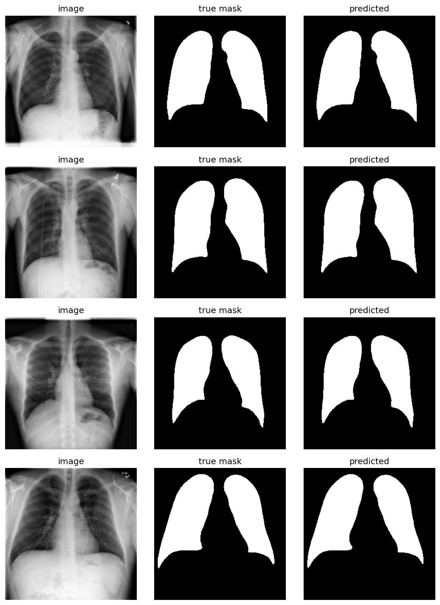

# Lung Segmentation with U-Net (PyTorch)

Chest X-ray lung segmentation using a U-Net built from scratch in PyTorch.

## Dataset
[Lung Mask Image Dataset](https://www.kaggle.com/datasets/newra008/lung-mask-image-dataset) (Kaggle, CC0).
21,165 chest X-rays with binary lung masks, split 16,932 train / 2,117 val / 2,116 test.
Images were resized to 256x256 grayscale. Masks are JPEG, so they are thresholded at 127.

## Model and training
- 4-level U-Net, 7.77M parameters, BatchNorm, skip connections
- Loss: BCE + Dice
- Adam (lr 1e-3), ReduceLROnPlateau, batch size 16, 8 epochs on a Colab T4
- Best checkpoint chosen by validation Dice

## Results

| Model | Val Dice | Test Dice | Test IoU | Test images with Dice < 0.9 |
|---|---|---|---|---|
| Baseline: 1 epoch | 0.959 | 0.9850 | 0.9711 | 12 of 2116 |
| 8 epochs | 0.977 | 0.9931 | 0.9864 | 4 of 2116 |

Validation Dice dips at epoch 3 and then recovers. Both curves were still improving at epoch 8, so more training would likely help.

Test Dice is higher than val and train Dice, so the provided test split may be easier than val or overlap with the training data. These scores are on the dataset's provided test split, not real-world performance.

## Failure analysis
I computed Dice per test image and inspected the worst cases.

- With 1 epoch, the worst image scored Dice 0.089 (a dark, low-contrast X-ray). After 8 epochs it scored 0.900.
- The weakest remaining case is a small, rotated chest inside a large black border (Dice 0.751), where the lungs cover few pixels at 256x256.
- Several other weak cases look like children's X-rays, with ragged edges and holes. (These causes are my hypotheses from looking at the images, not confirmed.)

## Next steps
- Augmentation (rotation, zoom, brightness/contrast) for the small and dark cases
- Higher resolution (512x512)
- Post-processing: keep the two largest connected components
- More epochs, since validation Dice was still rising at epoch 8
- Export to ONNX and serve with FastAPI in Docker

## How to run
Open `lung_segmentation_unet_clean.ipynb` in Google Colab with a T4 GPU. You need your own Kaggle API key (`kaggle.json`). Run the cells top to bottom (training takes about 1 hour).
