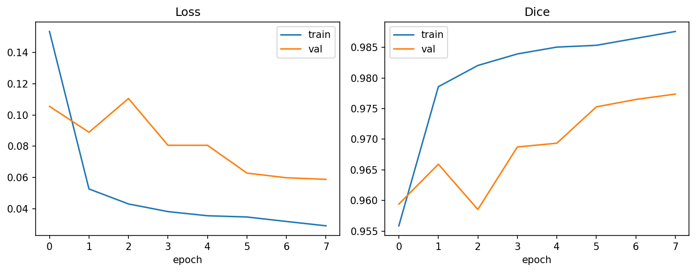
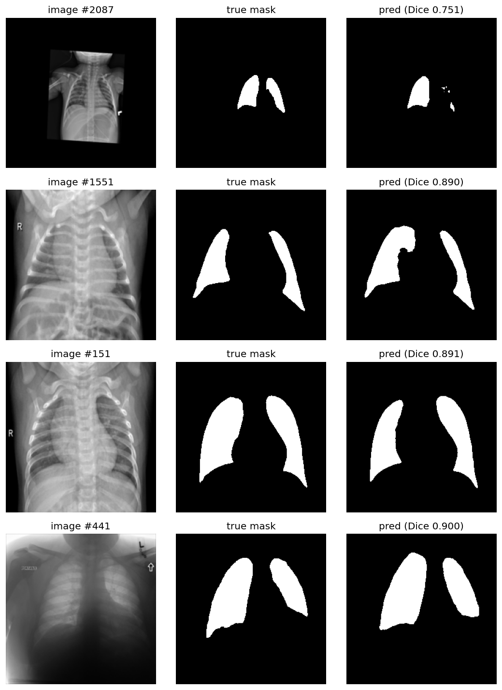

# Lung Segmentation with U-Net (PyTorch)

Chest X-ray lung segmentation with a U-Net written from scratch in PyTorch, with per-image failure analysis.

## Dataset
[Lung Mask Image Dataset](https://www.kaggle.com/datasets/newra008/lung-mask-image-dataset) (Kaggle, CC0):
21,165 chest X-rays with binary lung masks, split 16,932 train / 2,117 val / 2,116 test.
Images are resized to 256x256 grayscale. Masks are JPEG, so they are thresholded at 127.

## Model and training
- 4-level U-Net, 7.77M parameters, BatchNorm, skip connections
- Loss: BCE + Dice. Metrics: Dice and IoU
- Adam (lr 1e-3), ReduceLROnPlateau, batch size 16, 8 epochs on a single T4 GPU
- Best checkpoint chosen by validation Dice

## Results

| Model | Val Dice | Test Dice | Test IoU | Test images with Dice < 0.9 |
|---|---|---|---|---|
| Baseline: 1 epoch | 0.959 | 0.9850 | 0.9711 | 12 of 2116 |
| 8 epochs | 0.977 | 0.9931 | 0.9864 | 4 of 2116 |



Validation Dice dips at epoch 3 and then recovers. Both curves were still improving at epoch 8, so more training would likely help.


Test Dice is higher than val and train Dice, so the provided test split may be easier than val or overlap with the training data. These scores are on the dataset's provided test split, not real-world performance.

## Failure analysis
Dice was computed per test image and the worst cases inspected.



- With 1 epoch, the worst image scored Dice 0.089 (a dark, low-contrast X-ray). After 8 epochs it scored 0.900.
- The weakest remaining case is a small, rotated chest inside a large black border (Dice 0.751), where the lungs cover few pixels at 256x256.
- Several other weak cases look like children's X-rays, with ragged edges and holes. (These causes are hypotheses from visual inspection, not confirmed.)

## Project structure
```
src/
  dataset.py    Dataset class
  model.py      U-Net
  losses.py     BCE+Dice loss, Dice/IoU metrics
  engine.py     one training / evaluation epoch
  train.py      training script
  evaluate.py   test score, per-image CSV, worst-cases figure
  utils.py      seed and device helpers
notebooks/      original exploratory notebook
images/         figures used in this README
make_fake_data.py   tiny synthetic dataset for quick pipeline tests
```

## Usage
```bash
pip install -r requirements.txt

# download the data (needs a Kaggle API key)
kaggle datasets download -d newra008/lung-mask-image-dataset -p data --unzip

# train
python src/train.py --data-dir data/ChestXray --epochs 8 --out-dir outputs/baseline

# evaluate: test Dice/IoU, per-image CSV, worst-cases figure
python src/evaluate.py --data-dir data/ChestXray --checkpoint outputs/baseline/best.pth

# quick pipeline test on fake data
python make_fake_data.py
python src/train.py --data-dir data_fake/ChestXray --img-size 64 --base 8 --epochs 3 --batch-size 8 --num-workers 0
```

## Next steps
- Augmentation (rotation, zoom, brightness/contrast) for the small and dark cases
- Higher resolution (512x512), more epochs
- Post-processing: keep the two largest connected components
- Export to ONNX and serve with FastAPI in Docker
